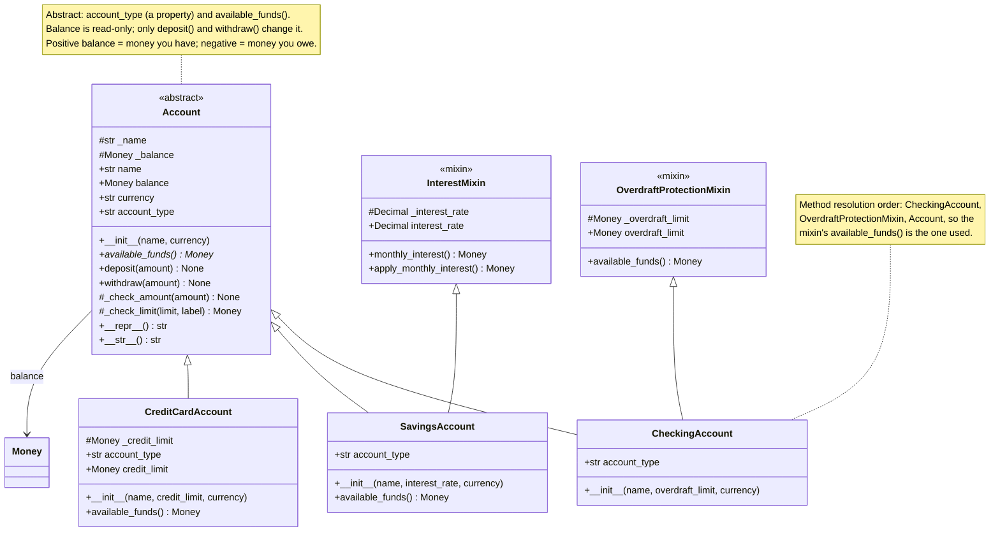
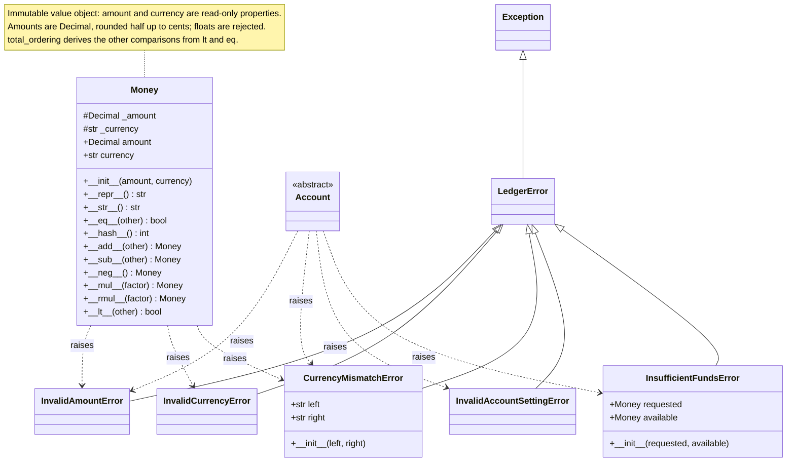

# Ledger

An offline personal finance tracker for Windows, written in Python.

Ledger lets you manage your personal finances on your own computer. You can create checking, savings and credit card accounts, record deposits, withdrawals and transfers, import transactions from a bank's CSV export, and view monthly statements and spending by category. All data is stored locally as JSON files, so Ledger needs no server, account or internet connection, and your data can't be lost to a service shutting down.

Ledger is my final project for CPTR212 Object Oriented Programming (Fall 2026). Its code is organized to demonstrate the course's object-oriented programming topics.

**Status:** in development (v0.1.0).

## Features

_Planned: a short list of what Ledger can do._

## Screenshots

_Planned: the main window, a monthly statement and the CSV import summary._

## Download and run

_Planned: how to download `Ledger.exe` from the v1.0.0 Release and run it, including a note on the Windows SmartScreen warning._

## Run from source

_Planned: how to clone the repository, install it and launch the app with `python -m ledger`._

## Run the tests

_Planned: how to run the `unittest` suite._

## Build the Windows executable

_Planned: how to build `Ledger.exe` with PyInstaller._

## Project structure

_Planned: what each package and module is responsible for._

## Class diagram

Classes are added here as they are built. Solid arrows with hollow heads show inheritance, a plain arrow shows that a class holds a value of another class, and dashed arrows show which errors a class raises. Members marked `#` are protected by convention, and methods in _italics_ are abstract.

### Accounts

### Money and errors

## Design notes

- **Money is exact.** Amounts are `Decimal` values rounded to cents, built from text, whole numbers or `Decimal`, never from `float`, because a float cannot store most cent values exactly. Adding or comparing two different currencies raises `CurrencyMismatchError` instead of giving a wrong answer.
- **One sign convention for every account.** A positive balance is money you have; a negative balance is money you owe. A credit card starts at $0.00, spending makes its balance negative, and a payment brings it back towards zero. The same rule lets one `withdraw()` method serve every account: it allows any amount up to `available_funds()`, which each account type defines (the balance for savings, the balance plus the overdraft limit for checking, the credit limit plus the balance for a credit card).
- **Optional features are mixins.** Interest and overdraft protection are features an account can have, not kinds of account, so they are mixin classes that any account type can reuse.

_Planned: all-or-nothing transfers, atomic saves and where data is stored._

## Known limitations

_Planned: what Ledger does not do._

## License

MIT. See [LICENSE](LICENSE).
